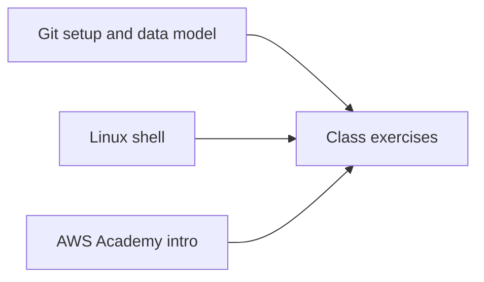

# COSC 381 — Software Engineering Solutions

College coursework portfolio for **COSC 381 — Software Engineering Solutions** at Eastern Michigan University (Spring 2022 era).  
Notes and exercises on **Git**, **Linux shell**, in-class problems, and **AWS Academy** coursework.

**Author:** [Julio Barros](https://github.com/Jkbarros)  
**Index:** [college-projects](https://github.com/Jkbarros/college-projects)

## What is in this repository

| Area | Description |
|------|-------------|
| [`archive/canvas-submissions/`](archive/canvas-submissions/) | Original DOCX exports (Git cheat sheets, shell notes, class exercises) |
| [`docs/screenshots/`](docs/screenshots/) | AWS Academy / lab screenshots |

### Topics covered

## Explore the archive

Primary materials live in **`archive/canvas-submissions/`**, including:

- Git setup and object model write-ups
- Git cheat sheets
- Linux shell reference notes
- Class exercises (e.g. Feb 7 session)
- Problem statements and reflection docs (`problem.docx`, `What People Say.docx`)

Screenshots under **`docs/screenshots/`** document AWS Academy progress from Canvas.

## Related repos

| Course | Link |
|--------|------|
| IA 103 — Information Security | [information-security-overview](https://github.com/Jkbarros/information-security-overview) |
| COSC 314 — Discrete Structures | [computational-discrete-structures](https://github.com/Jkbarros/computational-discrete-structures) |
| IA 455 — Incident Response | [incident-response-ia455](https://github.com/Jkbarros/incident-response-ia455) |

## Notes for readers

- This repo documents **my submitted work**; it is not a production codebase.
- Course materials owned by EMU are not redistributed beyond my submissions in `archive/`.

## License

Content © Julio Barros. Use at your own risk.
