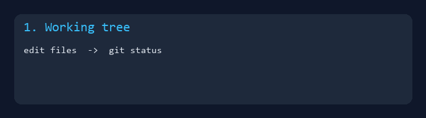
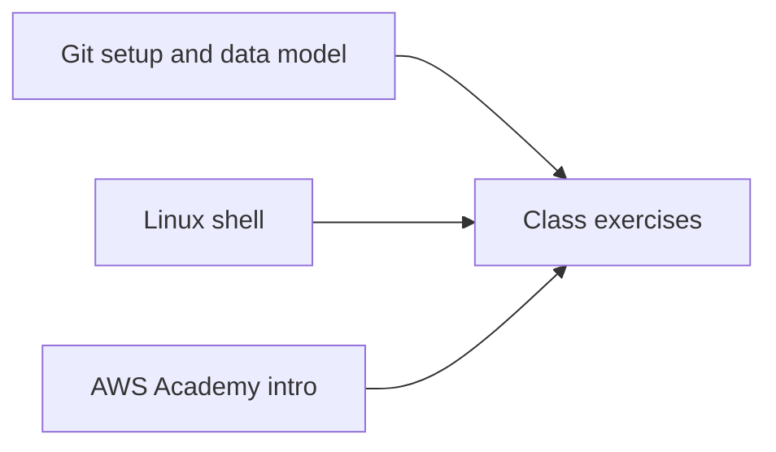

# COSC 381 - Software Engineering Solutions



College coursework portfolio for **COSC 381** at Eastern Michigan University (Spring 2022).  
Readable notes on **Git**, the **Linux shell**, in-class exercises, and **AWS Academy** screenshots.

**Author:** [Julio Barros](https://github.com/Jkbarros)  
**Index:** [college-projects](https://github.com/Jkbarros/college-projects)

## What is in this repository

| Area | Description |
|------|-------------|
| [Topics catalog](docs/topics-catalog.md) | Map each topic to markdown + archive file |
| [Git setup](docs/git-setup.md) | Local repo configuration notes |
| [Git data model](docs/git-data-model.md) | Objects, commits, branches |
| [Git cheat sheets](docs/git-cheat-sheet.md) | Quick reference (+ [supplement](docs/git-cheat-sheet-supplement.md)) |
| [Linux shell](docs/linux-shell.md) | Shell commands and coursework notes |
| [Class exercises](docs/class-exercise.md) | In-class work (+ [Feb 7 session](docs/class-exercise-feb7.md)) |
| [Problem & reflection](docs/problem-statement.md) | Problem write-up, [What People Say](docs/what-people-say.md) |
| [AWS Academy labs](docs/aws-academy-labs.md) | Screenshot walkthrough |
| [Archive index](docs/archive-index.md) | Direct links to all DOCX in `archive/` |
| [`archive/canvas-submissions/`](archive/canvas-submissions/) | Original DOCX exports |

### Highlights

- All Canvas DOCX converted to GitHub-friendly markdown under `docs/`
- Git workflow GIF for the README (`scripts/generate_readme_demo.py`)
- AWS Academy progress preserved as dated screenshots

## Topics covered



## Regenerate docs

```bash
pip install -r requirements.txt
python scripts/docx_to_markdown.py
python scripts/generate_readme_demo.py
```

## Related repos

| Course | Link |
|--------|------|
| COSC 111 - Programming & Data Structures | [programming-data-structures-cosc111](https://github.com/Jkbarros/programming-data-structures-cosc111) |
| COSC 314 - Discrete Structures | [computational-discrete-structures](https://github.com/Jkbarros/computational-discrete-structures) |
| IA 103 - Information Security | [information-security-overview](https://github.com/Jkbarros/information-security-overview) |
| college-projects index | [college-projects](https://github.com/Jkbarros/college-projects) |

## Notes for readers

- This repo documents **my submitted work**; it is not a production codebase.
- Course materials owned by EMU are not redistributed beyond my submissions in `archive/`.

## License

Content © Julio Barros. Use at your own risk.
