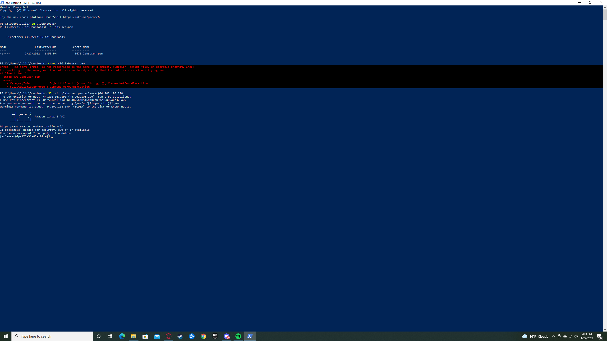
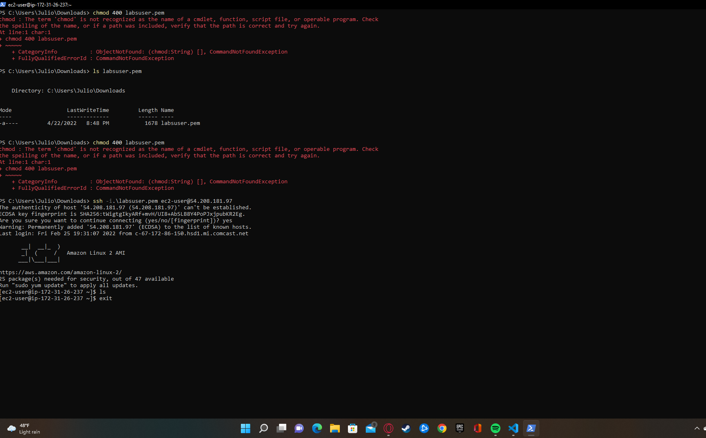

# AWS Academy — lab screenshots

**Course:** COSC 381 - Software Engineering Solutions (EMU) · **Author:** Julio Barros

Canvas/AWS Academy progress captured as PNG exports (Spring 2022). These are **point-in-time** views of the learner console, not live credentials.

| Screenshot | Description |
|------------|-------------|
|  | AWS Academy via Canvas (Opera snapshot, 2022-01-25) |
|  | Follow-up lab / module view (2022-01-27) |
|  | Supplementary screenshot from coursework folder |

## Notes

- Open the image files under [`docs/screenshots/`](screenshots/) for full resolution.
- Do not treat screenshots as operational runbooks; AWS console UIs change frequently.
